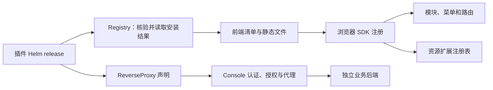

import ConsoleLayoutDiagram from "@site/src/components/ConsoleLayoutDiagram";

Console 由 Shell、业务模块和插件适配组成，宿主内部模型不改变插件公开合同。

## 界面区域

<ConsoleLayoutDiagram />

| 区域 | 宿主负责 | 插件贡献 |
| --- | --- | --- |
| 顶栏 | 品牌、用户、语言和偏好 | 当前远程适配不提供顶栏贡献 |
| 侧边栏 | 聚合菜单、过滤、统一渲染 | 按公共菜单合同声明入口与归属 |
| 内容区 | 路由容器、公共上下文 | 自有页面，或宿主资源页的局部扩展 |

页头、工具栏和业务主体属于内容区内部，由页面组合。Query、Router、Auth 等 Provider 是运行时上下文，不是屏幕上的独立区域。

## 两种前端接入

- **自有页面**：例如北极星实验列表，插件提供完整页面，通过菜单和路由访问。
- **宿主资源页扩展**：例如模型服务的关系 Badge，插件在 `collection.row`、`resource.header` 等稳定锚点贡献内容，宿主保留页面骨架和核心操作生命周期。

## 运行链路

## 宿主与领域边界

| 宿主拥有 | 插件拥有 |
| --- | --- |
| 资源身份、主查询和分页 | 领域数据与关联关系 |
| 稳定展示锚点 | 展示组件与业务文案 |
| 核心操作生命周期 | 附加操作策略与插件命令 |
| 会话、权限、共享运行时 | 业务 API、领域输入和状态校验 |

进一步阅读：[前端插件化](frontend-plugin.mdx)、[菜单合同](menu-contract.md)、[北极星实例](canary.md)。
