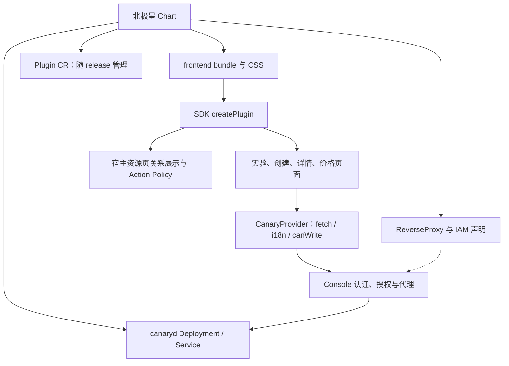

北极星独立交付领域页面和 canaryd，Console 提供共享运行时、资源锚点、认证和代理。

## 一张图看完整链路



## 前端改什么

| 部位 | 改造内容 |
| --- | --- |
| 入口 | `runtime.tsx` 调用 `createPlugin()` 声明贡献 |
| 自有页面 | 页面继续由北极星仓库维护，不复制进 Console |
| 公共依赖 | 构建时将 React、Router、Query 和 UI 接到宿主导出 |
| 适配层 | `console-runtime.tsx` 获取宿主请求、语言与能力 |
| Provider | 向业务页面传入 fetch、i18n、canWrite 和基础路径 |
| 样式 | 插件构建 CSS 并随包交付，宿主链接文件 |

当前北极星页面通过 `useCanaryApi()`、`useCanaryWrite()` 等业务 Hook 使用这些能力，不需要各处读取宿主内部对象。

## 不要把四种依赖混在一起

| 机制 | 发生阶段 | 解决的问题 |
| --- | --- | --- |
| Global `depends` | 安装前校验 | 前置插件与产品版本条件 |
| Chart `dependencies` | 打包与安装 | 子 Chart 组合 |
| `provides` / `consumes` | 安装器解析 | 提供方能力与环境配置绑定 |
| SDK / Provider | 构建与页面渲染 | 共享实例、请求、语言与页面能力 |

`depends` 不负责注入 React，`consumes` 不等于浏览器 Context，Secret 也不应以明文注入前端。

## 如何增强宿主资源页

北极星注册 Data、Visibility、Presentation 与 Action Policy，宿主传入资源类型、稳定身份和基础资源。

| 贡献 | 当前示例 |
| --- | --- |
| Data | 从 canaryState / managedBy / assignedTo 派生实验关系 |
| Presentation | 在 `collection.row` 和 `resource.header` 显示关系 Badge 与归属链接 |
| Visibility | 当前关系展示策略返回 true，不代表完整权威判定已完成 |
| Action Policy | 根据关系限制 SLO、升级、回滚和卸载 |

当前 Data 与 Action Policy 均从基础 resource 派生关系，并非 Action 已复用权威关系查询结果。权威关系 API、刷新合同、后端写保护和完整动态列 / Tab / 字段策略仍需演进。

## 后端要不要改

业务逻辑留在 canaryd，但需要对齐认证、路径与环境配置。

```text
浏览器 /api/canary/*
  → Console 会话认证
  → IAM backends/canary 权限检查
  → ReverseProxy 转发
  → canaryd 认证与领域校验
```

- `ReverseProxy` 来自已安装 release 的 rendered manifest，不是一个额外代理 Pod。
- 当前不 strip 路径前缀，canaryd 接收完整 `/api/canary/...`。
- Console 清理来访身份头和 Cookie，再设置经过认证的身份。
- 可信代理身份头本身没有签名，后端入口必须受控；业务后端保留输入、对象状态和资源关系检查。
- Swiss URL 和 Secret 引用由能力绑定进入配置，不放到浏览器中。

进一步阅读：[前端插件化](frontend-plugin.mdx)、[Chart 生命周期](lifecycle.md)、[跨平台目标](portability.md)。
