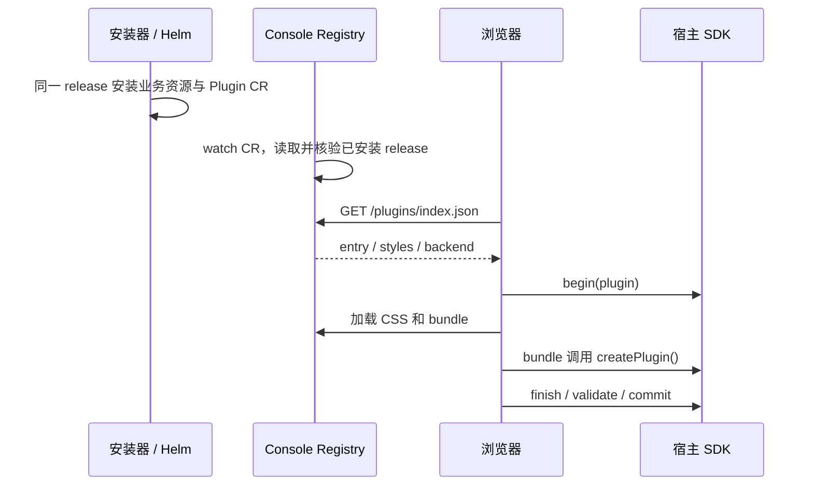

import ConsoleLayoutDiagram from "@site/src/components/ConsoleLayoutDiagram";

插件独立交付业务前端，通过宿主 SDK 注册菜单、路由、组件和资源扩展；Console 提供共享运行时与统一访问入口。

## 页面区域

<ConsoleLayoutDiagram />

完整界面区域定义见[架构与界面区域](architecture.mdx)。插件既可以提供完整业务页，也可以在宿主资源页的稳定锚点贡献局部内容。

## 从安装到浏览器注册



- Registry 只观察已安装结果，不执行 Helm 安装和升级。
- 前端文件来自 release 的 Chart 文件；后端路由声明来自已渲染的 release manifest。
- 注册失败会回滚本次扩展并清理入口资源，其他插件可以继续加载。
- 注册回滚不是任意 JavaScript 副作用的沙箱；安装变更后，已打开页面需要刷新。

## 插件入口

以下使用共同菜单合同声明多个入口。本工作区已实现多菜单适配并完成单测与类型检查，支持范围及待验收边界见[菜单与路由合同](menu-contract.md)。

```tsx
import { createPlugin } from '@modelsphere/plugin-sdk'
import { ListPage, PricingPage, DetailPage } from './pages'

createPlugin({
  name: 'example',
  version: '0.1.0',
  displayName: '示例插件',
  menus: [
    {
      name: 'list', title: '资源列表',
      path: '/modelsphere.dev/v1/example/list',
      scope: 'platform', group: '资源', order: 100,
    },
    {
      name: 'pricing', title: '价格配置',
      path: '/modelsphere.dev/v1/example/pricing',
      scope: 'platform', group: '配置', order: 200,
    },
  ],
  components: { List: ListPage, Pricing: PricingPage },
  routes: { 'list/[id]': DetailPage },
})
```

`menus` 决定导航入口，`routes` 决定额外可访问页面。选一个默认落地页不代表只注册一个菜单；详情页不必出现在侧边栏。

## 共享运行时与公共能力

使用 `@modelsphere/plugin-sdk/build` 的 `definePluginConfig()` 构建插件入口，将公共依赖映射到宿主导出，而不是把另一份 React、Router 和 Query 打进插件。

| 能力 | 当前接入 |
| --- | --- |
| React / JSX Runtime | 宿主共享实例与构建 shim |
| Router / Query | shared imports 对应宿主实例与上下文 |
| UI 组件 | 宿主 SDK 的 UI 导出面 |
| 认证请求 | SDK API Client 或当前宿主 `apiFetch` |
| 国际化 | 插件词条注册到宿主语言体系 |
| 资源上下文 | 宿主传入资源类型、稳定身份和基础资源 |

`__MODELSPHERE_SDK__`、`__GLOBAL_SDK__`、`__RISE_SDK__` 是同一宿主对象的别名。别名存在不等于两个平台的全部业务接口已兼容。

插件自身的 Provider 将请求、语言和写能力传给业务页面。Provider 属于 React 上下文，不是可见界面区域。

## 资源扩展

| 合同 | 插件负责 | 宿主负责 |
| --- | --- | --- |
| Data | 查询或派生领域关联数据 | 稳定资源身份、基础资源与缓存接入 |
| Visibility | 扩展是否显示及不可用原因 | 与宿主权限和资源状态合并 |
| Presentation | 组件、位置和交互呈现 | 在稳定锚点渲染 |
| Action Policy | 领域状态限制 | 核心操作生命周期与最终执行 |

当前锚点包括 `collection.row` 和 `resource.header`。完整动态列、详情 Tab、表单字段策略不能仅凭接口类型存在就视作已落地。

## 后端接入

插件页面使用同源 `/api/<plugin>/*`。插件 Chart 交付 `ReverseProxy` 和 IAM 声明，Console 负责会话认证、后端权限检查和转发，业务服务继续独立运行。

`ReverseProxy` 是声明，不会为每个 CR 启动一个代理 Pod。菜单权限也不能替代后端授权和领域校验。

继续阅读：[生命周期](lifecycle.md)、[北极星实例](canary.md)、[同一插件跨平台](portability.md)。
