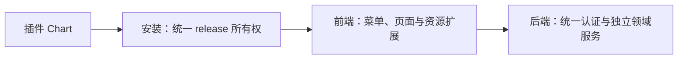

Console 是承载内建模块与独立业务插件的宿主。开发者通过共同的插件合同接入导航、页面、资源扩展和后端 API。

## 阅读路径

| 你要做什么 | 从这里开始 |
| --- | --- |
| 理解界面区域与宿主职责 | [Console 架构](architecture.mdx) |
| 本地运行服务与前端 | [本地开发](local-development.md) |
| 为 Console 开发远程前端插件 | [前端插件化](frontend-plugin.mdx) |
| 注册多个菜单、分组及详情路由 | [菜单与路由合同](menu-contract.md) |
| 打包、安装、升级、卸载插件 | [Chart 与 Plugin CR 生命周期](lifecycle.md) |
| 看一个完整业务的接入方式 | [北极星改造实例](canary.md) |
| 理解为什么要与 Global 沿用同一规范 | [一个插件，两个平台](portability.md) |

## 三个边界

- **交付边界**：Plugin CR 随插件 Chart 的同一 release 安装、升级、卸载。
- **前端边界**：宿主提供稳定 SDK 和界面锚点，插件拥有自己的领域页面和策略。
- **后端边界**：Console 认证、授权和代理，业务后端保留领域校验。

## 目标与实现状态

核心愿景是同一个插件制品既能用于 Console，也能用于 Global，不修改业务代码、不重新构建。

| 项目 | 本站口径 |
| --- | --- |
| 菜单定义 | 沿用 Global 合同，不为 Console 另立规则 |
| 多菜单适配 | 本工作区已实现并通过单测、类型检查，待发布与集群验收；范围见菜单合同 |
| Plugin CR 所有权 | 已确定由插件 Chart 管理，不再把独立 apply 作为标准流程 |
| 同包双端运行 | 目标，需要使用同一制品完成双端验收 |

文档核对日期：2026-11-20。页面中的目标合同不等于已完成发布或集群验收。
