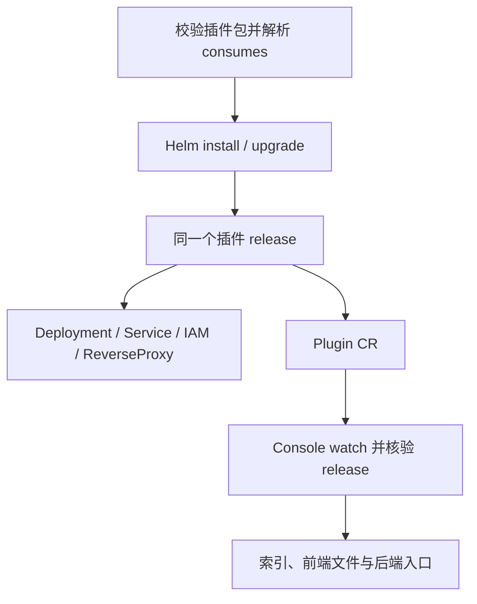

最终决定：Plugin CR 由插件 Chart 创建，与业务资源归属同一个 Helm release，统一安装、升级和卸载。

## 标准链路



| 操作 | 规则 |
| --- | --- |
| 安装 | Chart 创建运行资源和注册 CR，不再额外独立 apply 注册文件 |
| 升级 | 同一 release 同步更新资源与 CR spec；固定 Chart 版本随 `.Chart.Version` 更新 |
| 停用 / 恢复 | 通过 Chart values 管理 `spec.enabled`，可保留 release |
| 卸载 | Helm 删除该 release 管理的 CR 和资源，不提前独立删除注册 |
| 状态 | Console 观察安装结果并写 status，不执行 Helm 生命周期 |

## CRD 与 CR 的所有权

- 平台安装提供 `Plugin` CRD。
- 插件 release 拥有自己的 Plugin CR 实例。
- 实例模板放在插件 Chart 的 `templates/`，不放进 Helm 不随卸载删除的 `crds/`。
- Chart 不写观察状态；Console 使用 status 子资源回写核验结果。

## Chart 模板要求

| 字段 | 来源 |
| --- | --- |
| 插件身份 | `plugin.yaml` 的 group / name，并使用平台统一身份编码 |
| `spec.version` | `.Chart.Version`，不是产品版本 `plugin.yaml.version` |
| `spec.chart.name` | `.Chart.Name` |
| `spec.chart.namespace` | `.Release.Namespace` |
| `spec.chart.releaseName` | `.Release.Name` |
| `spec.enabled` | Chart values；北极星工作区采用 `registration.active` |

不把手工 patch / delete CR 写成常规停用或卸载步骤。仅部署业务服务而刻意不接入 Console 时，可以显式关闭注册模板。

## Console 核验什么

```text
Plugin CR
  → release 可读且为 deployed
  → Chart 名与版本一致
  → plugin.yaml 身份一致
  → frontend 入口真实存在
  → 发布索引与静态文件
```

注册存在不代表插件可用。检查 CR status、Console 日志和浏览器入口加载错误，定位具体断点。

## 当前对齐项与验收

旧 CLI 曾有“先删除注册、再卸载 Helm”的路径，应对齐本页的统一所有权决定；是否完成以对应版本源码与测试为准，不把旧行为继续列作标准步骤。

- 安装后，CR、release 和插件索引一致。
- 升级后，注册固定的 Chart 版本与实际 release 一致。
- 停用与恢复由 values 管理，不被后续升级意外覆盖。
- 卸载后，入口与 Chart 管理的资源移除；业务数据保留由各 Chart 策略决定。
- 已打开浏览器需要刷新，不承诺撤销已执行 JavaScript 的任意副作用。

Global 的 CR 是控制器执行安装的期望状态，Console 的 CR 是 Chart 管理的注册声明。两者的生命周期驱动方向不同，跨平台制品需要[宿主安装适配](portability.md)。
