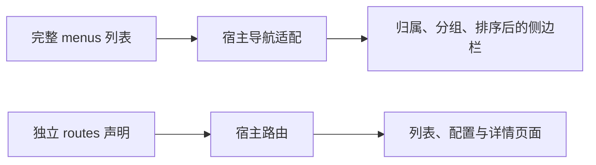

Console 沿用 Global 的插件菜单定义。内部可以采用 `ConsoleModule`，但不能改变同一份插件声明的含义。

## 最终效果



| 声明 | 合同语义 |
| --- | --- |
| `menus[]` | 完整注册菜单列表，而非只取第一个 |
| `path` | 页面路径；多段插件路径不应被截断为单段模块名 |
| `name` | 沿用 kebab-case → PascalCase 组件 key 映射 |
| `parent` | 侧边栏归属；页面和组件仍由贡献插件拥有 |
| `group` / `order` | 分组与排序，数值较小的菜单靠前 |
| `hidden` | 隐藏导航项，但保留路由，不等于授权拒绝 |
| `authKey` | UI 权限过滤，后端仍独立授权 |
| `scope` | 资源上下文，不等于 UI 的 viewport |
| `routes` | 注册额外页面，详情页无需生成侧边栏菜单 |

默认落地页的选择与菜单注册独立：选择一个落地页不能丢弃其余菜单。

## 示例：两个菜单，一个详情路由

```text
插件声明                         侧边栏
menus:                           北极星
  实验列表，group=实验              实验
  价格配置，group=配置                实验列表
                                   配置
routes:                              价格配置
  experiments/[id] → 实验详情
```

用户点击实验列表中的某个实验进入详情页。详情有 URL，但不会因此产生一个固定侧边栏条目。

## Console 的实现范围

本工作区已实现以下适配，待发布与真实插件集群验收。旧版只取第一个菜单是已修正的实现缺口，不是另一套规范。

| 范围 | 当前实现 |
| --- | --- |
| 完整菜单与独立路由 | 支持全部 `menus`、动态路由和菜单外详情页 |
| 路径与组件 | 支持多段插件 namespace、PascalCase 映射及旧 raw key 回退 |
| 隐藏与权限 | hidden 保留路由；authKey 同时用于导航过滤和页面守卫 |
| 侧边栏归属 | parent / group / order、正确的激活项与详情页侧边栏定位 |
| parent 目标不可用 | 不显示贡献菜单；页面路由仍属于贡献插件 |
| 上下文 | platform 的 scope / requiredScope；其他 scope 明确报错 |
| 不支持的声明 | 非空 children、带 query / hash 的菜单路径明确报错 |
| 图标 | 保留 boxes、flask-conical、puzzle 三个允许值 |

当前不提供 Global 完整 Dock、Boss / Console 双视角控制面或多 scope 选择器，不能以本次菜单适配代表全面兼容。

验证记录：2026-11-20，Console 与 Swiss 类型检查通过；限定 `maxWorkers=2` 的完整前端回归为 80 个文件、751 个测试通过。尚未完成真实插件集群与浏览器端到端验收。

Global 原规范参见[菜单注册](http://127.0.0.1:3000/frontend/menu-registration/)和[Scope 与 Viewport](http://127.0.0.1:3000/frontend/scope-and-viewport/)。这两个链接指向本机单独运行的 Global 文档站，不是本站页面。
