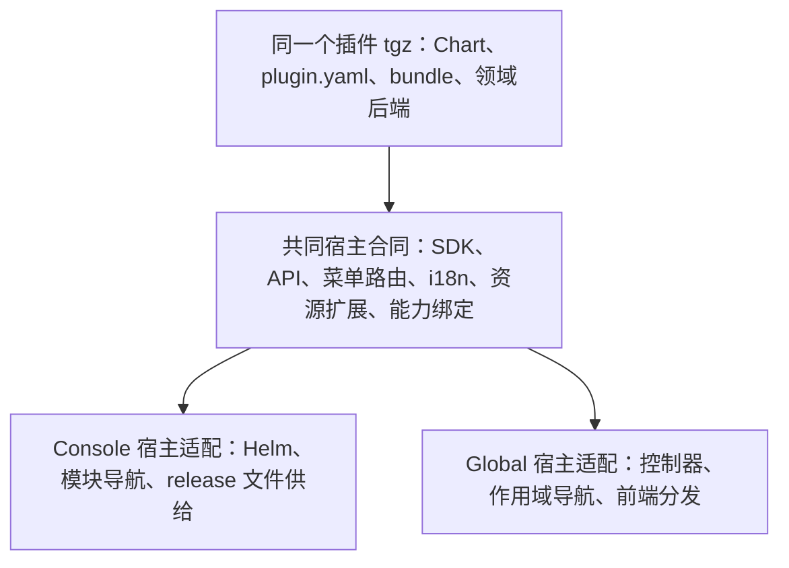

核心愿景：**同一个插件制品，不修改业务代码、不重新构建，既能用于 Console，也能用于 Global。**

独立交付、宿主解耦和稳定扩展合同是实现条件，不是替代跨平台复用的另一套愿景。

## 插件固定，合同一致，平台各自适配

| 层次 | 约束 |
| --- | --- |
| 插件 | 同一制品，不分别维护两套平台版本，只使用公开合同 |
| 机制 | SDK、菜单、资源扩展与能力声明 / 绑定的语义一致 |
| 平台 | 安装器、框架、控制面和文件分发允许不同，由宿主适配 |

Console 内部可以使用 `ConsoleModule`，Global 可以使用自己的导航注册表；它们应解释同一份菜单声明，而不是要求业务插件改写菜单含义。

## 当前还要收敛什么

- **能力访问**：将 `business.console`、`/api/capabilities` 等平台特定耦合收敛为稳定 SDK 能力或兼容适配。
- **资源扩展**：两端对齐资源身份、上下文、UI 锚点和操作策略合同。
- **生命周期**：保留 Global 的 CR 驱动安装与 Console 的 Chart 管理 CR，通过安装适配处理差异。
- **环境配置**：通过 `provides` / `consumes` 显式声明并绑定，避免业务依赖某个平台的地址、Secret 或 values 结构。

## 验收标准

使用**同一版本、同一校验和**的制品，在两端分别验证：

1. 安装、升级和卸载。
2. 菜单、页面路由和动态详情。
3. 真实 API 请求、认证与权限负例。
4. 宿主资源扩展与操作策略。

当前没有完整的同包双端验收结果，不能写成已经全面兼容。SDK 全局对象别名一致只是入口基础，不等于所有业务能力已经对齐。

本页总结 2026-11-16 的可移植性讨论，并纳入 2026-11-19 的 Chart 所有权决定及本轮菜单合同确认。
